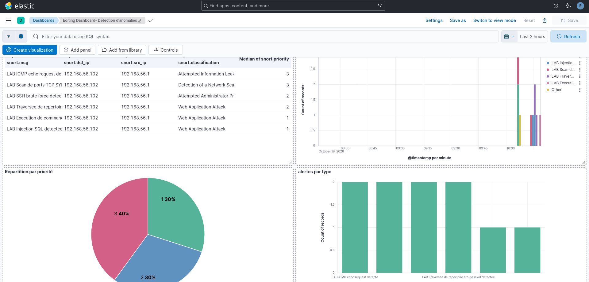
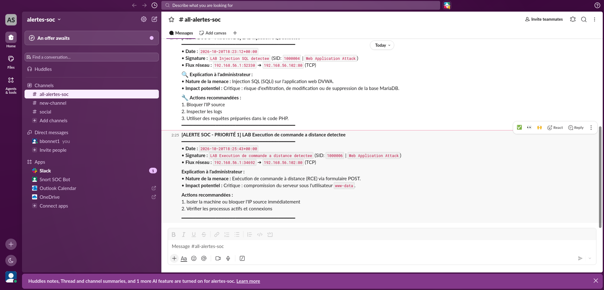

# Guide d'utilisation et de reproduction des scénarios

Ce document explique comment démarrer l'environnement, reproduire les cinq scénarios d'intrusion depuis la machine attaquante et analyser les résultats dans l'interface Kibana.

---

## 1. Prérequis et vérification des services

Avant de lancer les tests, assurez-vous que les deux machines communiquent sur le réseau privé isolé (`192.168.56.0/24`) :
- **Machine attaquante (Kali Linux) :** `192.168.56.1`
- **Machine défenseur (Ubuntu Server) :** `192.168.56.102`

Sur la VM **défenseur**, vérifiez que l'ensemble des services de la chaîne de détection et la cible web sont actifs :

```bash
sudo systemctl status snort syslog-ng elasticsearch kibana apache2 mariadb
```

Si l'un des services est arrêté, relancez toute la pile avec :

```bash
sudo systemctl start mariadb apache2 elasticsearch kibana snort syslog-ng
```

---

## 2. Reproduction des scénarios d'attaque (depuis Kali Linux)

Toutes les commandes suivantes sont à exécuter depuis un terminal sur la machine **Kali Linux (`192.168.56.1`)**.

### Test initial — Validation de la chaîne (Ping ICMP — Priorité 3)
Permet de vérifier que Snort détecte le trafic sur l'interface `enp0s8` et que `syslog-ng` transmet bien les événements à Elasticsearch (`sid:1000001`).

```bash
ping -c 2 192.168.56.102
```

### Scénario 1 — Reconnaissance : Scan de ports TCP SYN (`sid:1000002` — Priorité 3)
Envoie une rafale de paquets `SYN` sur les 100 ports les plus courants. La règle se déclenche dès que le seuil de 20 paquets `SYN` en moins de 5 secondes est franchi.

```bash
sudo nmap -sS -F 192.168.56.102
```

### Scénario 2 — Force brute sur SSH (`sid:1000003` — Priorité 2)
Simule une attaque par force brute sur le port 22 avec 4 tâches en parallèle. La règle se déclenche dès 3 nouvelles connexions SSH en moins de 30 secondes.

```bash
hydra -l root -x 1:1:a -t 4 ssh://192.168.56.102
```

### Scénario 3 — Injection SQL / SQLi (`sid:1000004` — Priorité 1)
Envoie une requête HTTP `GET` malveillante contenant une apostrophe encodée (`%27`) dans le paramètre `id=` de la page vulnérable de DVWA.

```bash
curl "http://192.168.56.102/vulnerabilities/sqli/?id=1%27+OR+%271%27=%271&Submit=Submit"
```

### Scénario 4 — Traversée de répertoire / Path Traversal (`sid:1000005` — Priorité 2)
Tente de remonter l'arborescence du serveur web pour lire le fichier système `/etc/passwd`.

```bash
curl "http://192.168.56.102/vulnerabilities/fi/?page=../../../etc/passwd"
```

### Scénario 5 — Exécution de commande à distance / RCE (`sid:1000006` — Priorité 1)
Envoie une requête HTTP `POST` sur le formulaire de test réseau de DVWA en injectant un point-virgule encodé (`%3B`) après l'adresse IP afin d'exécuter une commande système (`cat /etc/passwd`).

```bash
curl -X POST "http://192.168.56.102/vulnerabilities/exec/" -d "ip=127.0.0.1%3Bcat+/etc/passwd&Submit=Submit"
```

---

## 3. Vérification locale des logs sur la VM défenseur

En cas de besoin de diagnostic avant la visualisation dans Kibana, vous pouvez consulter en temps réel le fichier d'alertes généré par Snort :

```bash
sudo tail -f /var/log/snort/snort.alert.fast
```

---

## 4. Visualisation et lecture du tableau de bord Kibana

Rendez-vous sur l'interface web de Kibana depuis le navigateur : **`http://192.168.56.102:5601`**, puis ouvrez le menu **Analytics -> Dashboards -> Détection d'anomalies**.



### Explication de la lecture du Dashboard pour l'administrateur SOC

Le tableau de bord personnalisé est divisé en quatre panneaux complémentaires permettant une analyse rapide d'un incident :

1. **Table récapitulative des alertes (en haut à gauche) :**
   - Regroupe les événements par signature (`snort.msg`), adresse IP cible (`snort.dst_ip` : `192.168.56.102`), adresse IP attaquante (`snort.src_ip` : `192.168.56.1`), classification (`snort.classification`) et niveau de priorité (`Median of snort.priority`).
   - Permet d'identifier immédiatement l'origine d'une attaque et les vecteurs utilisés par une même adresse IP.
2. **Chronologie des événements `@timestamp` (en haut à droite) :**
   - Affiche la distribution temporelle des alertes minute par minute, colorée par type d'attaque.
   - Permet de reconstituer la chronologie d'une intrusion (par exemple : observer une phase de reconnaissance `Scan de ports` suivie quelques minutes plus tard d'une exploitation `Injection SQL` ou `RCE`).
3. **Répartition par priorité (camembert en bas à gauche) :**
   - Synthétise la proportion des alertes selon leur gravité :
     - **Priorité 1 (Critique — 30 %) :** Compromissions applicatives directes (`Injection SQL` et `Exécution de commande à distance`). Ce sont ces alertes qui déclenchent une notification immédiate à l'administrateur.
     - **Priorité 2 (Moyenne — 30 %) :** Tentatives d'intrusion par dictionnaire (`SSH brute force`) et divulgation de fichiers (`Traversée de répertoire`).
     - **Priorité 3 (Faible — 40 %) :** Reconnaissance réseau (`Scan de ports TCP SYN` et `ICMP echo request`).
4. **Volume d'alertes par type (histogramme en bas à droite) :**
   - Compare la fréquence de déclenchement de chaque règle afin de repérer les attaques les plus insistantes et de vérifier l'efficacité des filtres de seuils (`threshold.conf`).


## 5. Notifications en temps réel sur Slack

Lorsqu'une alerte de **Priorité 1** (compromission critique : Injection SQL ou RCE) est détectée par Snort, `syslog-ng` filtre l'événement (`f_snort_critique`) et le transmet au script Python `point_bonus/alertes_slack.py`. Ce dernier envoie instantanément une notification formatée dans le canal Slack du SOC avec l'explication de la menace et les mesures de remédiation pour l'administrateur :


