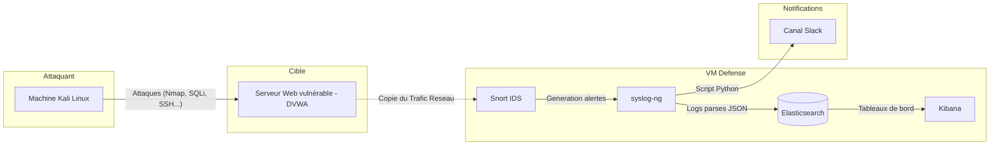

# Système de détection d'anomalies et de gestion de logs

Ce projet a été réalisé dans le cadre du cours de sécurité informatique. 
L'objectif étant de construire une chaîne complète sur une machine virtuelle Ubuntu Server dédiée 
permettant détecter des intrusions et de visualiser les alertes.

## Architecture

## Scénarios d'intrusion couverts

1. Reconnaissance — scan de ports (nmap)
2. Force brute — authentification SSH (hydra)
3. Injection SQL (DVWA)
4. Traversée de répertoire — lecture de /etc/passwd (DVWA)
5. Exécution de commande à distance — RCE (DVWA)

## Structure du dépôt

- INSTALLATION.md — mise en place de l'environnement, pas à pas
- CONFIGURATION.md — configuration de Snort, syslog-ng, Elasticsearch, Kibana
- GUIDE_UTILISATION.md — comment relancer et tester les scénarios
- SCENARIOS.md — description et justification de chaque scénario
- ANALYSE_ET_CONCLUSION.md — limites, difficultés rencontrées, perspectives
- snort/ — règles locales et seuils d'alerte
- syslog-ng/ — configuration de collecte et d'envoi vers Elasticsearch
- elasticsearch/ — rôle, utilisateur, modèle d'index
- screenshots/ — captures justificatives
- point_bonus/ — améliorations additionnelles

## Auteurs : 

-  Baptiste Bonnet
-  Adrien Clozel
-  Eliott Venance
